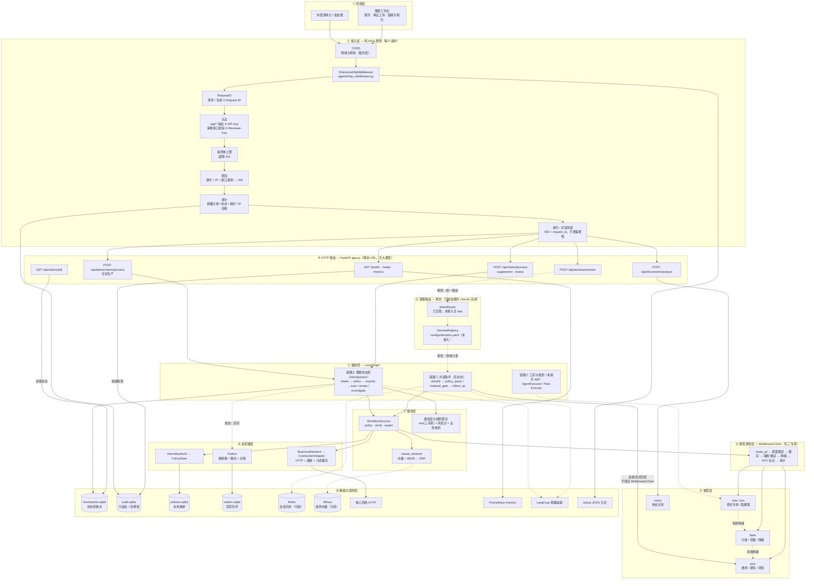
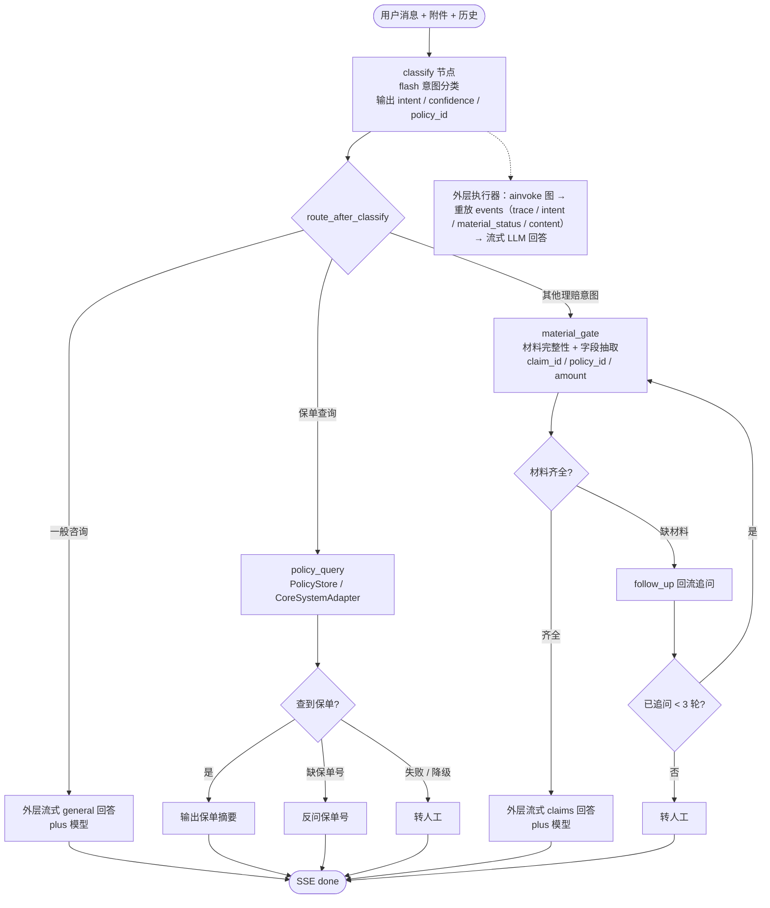
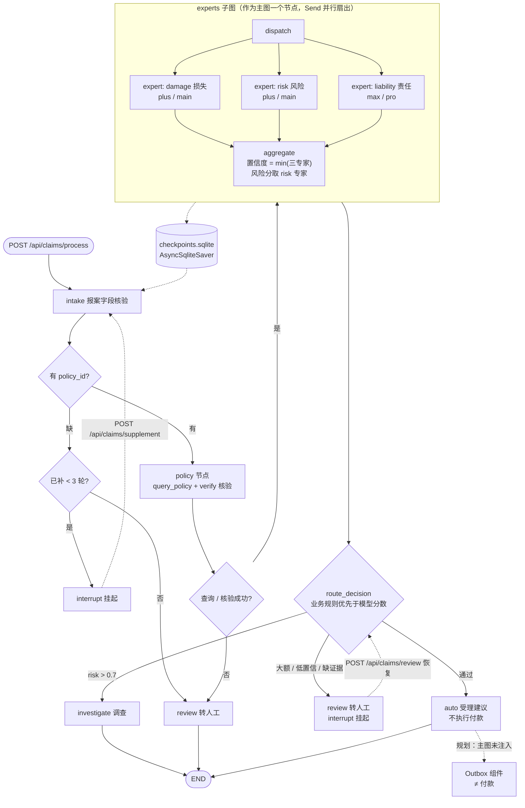
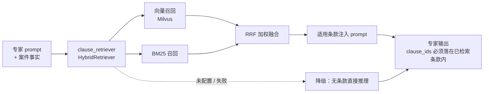
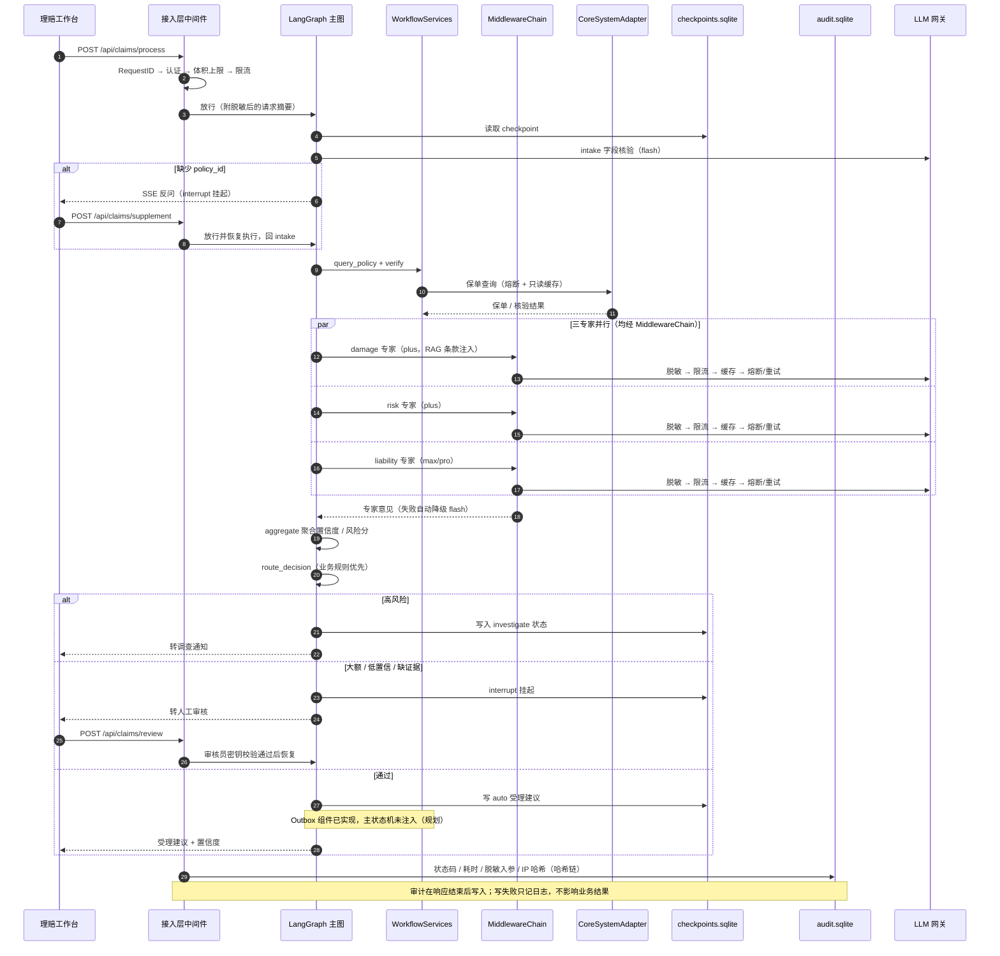
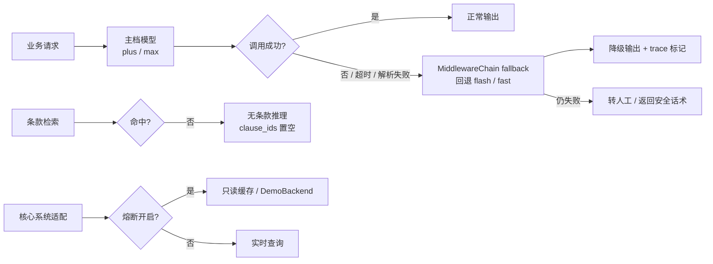
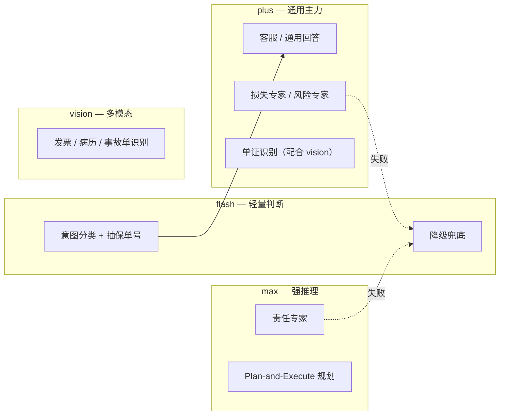

# 理赔 AI Agent 完整链路图

> 依据 `Architecture.md`、`docs/platform-architecture-workflow.md`、`app.py`、`agents/` 整理。
> 实线 = 当前代码已落地；虚线 = 规划中 / 可选注入 / 降级路径。
> 2026-10 更新：接入层统一中间件、审计库（哈希链）、`/ready` 已落地，总图与时序图同步调整。

---

## 一、端到端全景链路（总图）

### 组件功能说明（按层）

读图顺序：所有请求从 ① 终端进入 ② 接入层，再到 ③ 路由；对话链路在助手图内用 `classify` 分诊（④ 的 `IntentRouter` 已实现但未接入），理赔链路直接进入 ⑤ 状态机。专家调用从 ⑦ 服务层进入 ⑥ 模型调用层，再到 ⑨ 模型档位；落盘与观测集中在 ⑩。

| 层 | 组件 | 功能作用 | 代码位置 |
| --- | --- | --- | --- |
| 接入 | CORS | 处理跨域与预检；放在最外层，保证认证/限流失败响应也带 CORS 头 | `app.py`（`create_app`） |
| 接入 | `EnterpriseHttpMiddleware` | 纯 ASGI 统一管线，不缓冲响应、兼容 SSE；新增路由自动继承 | `agents/http_middleware.py:107` |
| 接入 | RequestID | 校验并透传 `X-Request-ID`，非法则生成 UUID；写入上下文和响应头 | `agents/http_middleware.py` `_request_id` |
| 接入 | 认证 | `/api/*`（除 `/api/demo/*`）校验 `X-API-Key`；审核接口另校验 `X-Reviewer-Key`；生产启动强制配置 | `_authenticate` + `app.py` |
| 接入 | 限流 | 通用 / 流式 / 单证三类桶，按「身份 + IP」计数；当前为进程内实现 | `HttpRateLimiter`（`agents/http_middleware.py:75`） |
| 接入 | 审计 | 落库前 `mask_pii`；记录 request_id、状态、耗时、脱敏入参、IP 哈希；写失败不阻断业务 | `_audit` + `agents/audit_store.py:27` |
| 接入 | 健康探针 | `/health` 只看存活；`/ready` 检查理赔图与审计库，未就绪返回 503 | `app.py:240` |
| 路由 | FastAPI 路由 | 纯 URL 静态匹配，不做大模型判断 | `app.py` |
| 路由 | IntentRouter / DomainRegistry | 已实现，**未接入主 app**；当前对话链路在图内 `classify` 分诊 | `claims_platform/` |
| 编排 | 对话助手图 | `classify → policy_query / material_gate → follow_up / formal_review / investment_trade`，无 checkpointer | `agents/assistant_agent.py` |
| 编排 | 理赔状态机 | `intake → policy → experts → route_decision`，`interrupt()` + checkpoint 支持补件/人工恢复 | `agents/claim_agent.py` |
| 编排 | 工具与规划 | AgentExecutor / Plan-Execute，尚未接入主 app | `agents/claim_agent.py` |
| 模型 | `MiddlewareChain` | 三专家调用治理：脱敏 → 按案限流 → 缓存 → 熔断/重试 → 降级 → HITL 标记 → stdout 审计 | `agents/middleware_audit.py:164` |
| 模型 | 模型档位 | flash 分类/轻量，plus 通用/损失/风险，max/pro 责任专家，vision 单证 | `config.py:134` |
| 服务 | `WorkflowServices` | `policy` / `verify` / `expert` 三个能力，注入条款检索器 | `agents/claim_agent.py:36` |
| 服务 | `clause_retriever` | 向量 + BM25 → 加权 RRF；未配置或失败降级为无条款 | `tools/rag_retrieval.py` |
| 服务 | 置信度聚合 | 置信度取三专家最小值，风险分取 risk 专家；决策时业务规则优先 | `agents/confidence.py` + `route_decision` |
| 适配 | DemoBackend / PolicyStore | 本地合成保单与理赔历史，供演示和离线测试 | `tools/policy_store.py` |
| 适配 | BusinessBackend / CoreSystemAdapter | 真实保单查询与核验：HTTP + 熔断 + 只读缓存 | `adapters/business.py` |
| 适配 | Outbox | 幂等键 + 租约 + 对账；组件已实现，**主状态机未注入**；入队 ≠ 付款 | `tools/claim_write_producer.py:15` |
| 数据 | `checkpoints.sqlite` | 状态机断点 / `interrupt()` 恢复 | `AsyncSqliteSaver` |
| 数据 | `audit.sqlite` | 请求审计，只追加 + 哈希链，可检测篡改 | `agents/audit_store.py` |
| 数据 | `policies.sqlite` / `outbox.sqlite` | 本地保单数据 / 回写队列（组件已实现，主图未注入） | `tools/` |
| 数据 | Redis / Milvus | 会话历史 / 条款向量，均为可选注入 | `agents/memory.py` / `tools/rag_retrieval.py` |
| 观测 | Prometheus | 六组业务指标，经 `/metrics` 暴露 | `monitoring.py` |
| 观测 | LangFuse | 脱敏后的模型调用链追踪 | `agents/observability.py` |
| 观测 | stdout JSON | 结构化日志与模型层审计明细 | `configure_logging` |

> 入口差异（旧图已纠正）：对话助手在助手图内用 `classify` 分诊；理赔接口直接进入状态机；`IntentRouter` 已实现但未接入主 app。
> 专家调用经过 `MiddlewareChain`；对话回答是外层直接流式输出，不经过该链。

---

## 二、链路①：对话助手（`/api/assistant/stream`）

> 链路① 只做「对话预审」，不触发正式核赔，trace 中明确标注"未调用业务保单接口"。

---

## 三、链路②：理赔状态机（`/api/claims/*`）

### 专家子图的检索增强（RAG）

---

## 四、一次案件请求的时序（含人工介入）

---

## 五、降级与兜底链路

---

## 六、存储与副作用落点

| 存储 | 归属链路 | 作用 | 备注 |
|---|---|---|---|
| `checkpoints.sqlite` | 链路② | 状态机断点 / interrupt 恢复 | `AsyncSqliteSaver` |
| `audit.sqlite` | 接入层 | 请求审计、哈希链、篡改检测 | 只追加；多副本前换 Postgres/WORM |
| `policies.sqlite` | 链路① | 本地保单模拟数据 | `PolicyStore` |
| `outbox.sqlite` | 链路②（规划） | 赔付 / 通知回写队列；组件已实现，主图未注入 | **入队 ≠ 付款** |
| Redis | 链路① | 会话历史 | 可选注入 |
| Milvus | experts 子图 | 条款向量检索 | 可选注入 |
| 核心系统 HTTP | 链路② | 真实保单 / 理赔核验 | 熔断 + 只读缓存 |
| LangFuse | 全链路 | 脱敏追踪 | 外部自托管 |
| Prometheus | 接入层 | `/metrics` | 公网部署时应在网关限制 |

> 限流桶、TTL 缓存都是**进程内**状态，重启即清空、多副本不共享；需要横向扩容时先换 Redis。

---

## 七、模型档位分布

