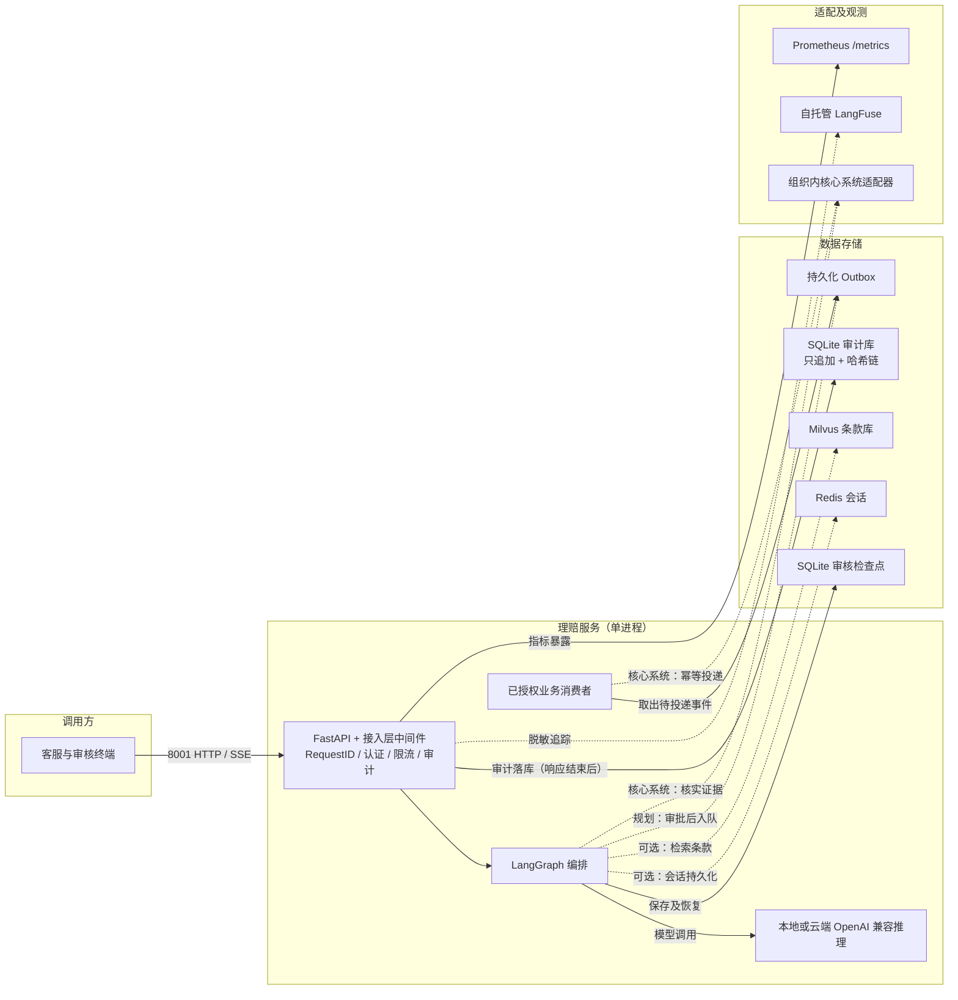

# 本地部署架构

会话和检索为可选注入；Outbox 组件已实现但主图未接入。真实接口须配置后启用。当前 HTTP 示例为单工作进程；不要直接据此增加副本。

- `/health` 只表示进程存活，`/ready` 额外检查理赔图与审计库。
- 接入层限流桶、模型层 TTL 缓存都在进程内；多副本部署前需换 Redis。
- 审计链校验：`python -m scripts.audit_verify --limit 10`（退出码 0 = 完整）。
