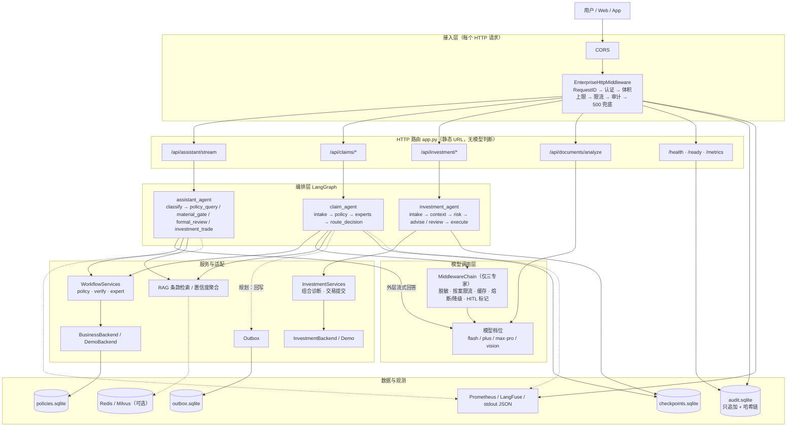

# AI Agent 平台：架构与工作流

> 版本：v0.2（2026-10）  
> 适用范围：当前仓库的理赔对话、理赔案件、投资域，以及规划中的统一领域路由。  
> 标记说明：`[已落地]` 代码已实现并通过测试；`[已实现未接入]` 代码存在但主 app 未使用；`[部分]` 部分能力已实现；`[规划]` 尚未实现。

---

## 0. 先看结论

这套系统可以类比成一家医院：

| 医院 | 系统 |
|---|---|
| 前台 | FastAPI 接入层 |
| 分诊台 | `IntentRouter` 意图路由（目标态；当前为图内 `classify`） |
| 科室 | `DomainPlugin`（目标态；当前为三张图） |
| 医生问诊、检查 | LangGraph 图执行 |
| 化验、影像、会诊 | RAG、三专家并行、工具调用 |
| 主任复核 | HITL 人工审核 |
| 挂号、病历、支付系统 | Capability SPI |

一句话：

```text
分诊台只负责“去哪个科室”，不负责“怎么治病”；
科室才是业务，底层系统负责可扩展。
```

补充：当前代码**还没有统一分诊台**。对话链路在 `assistant_agent.classify` 节点内分诊；理赔和投资接口直接进入各自图；`IntentRouter` 已实现，但主 app 尚未接入。

---

## 1. 分层架构图

> 先分清两张图：**1.1 是当前代码（v0.2）**；**1.3 是目标态**（统一 IntentRouter + DomainPlugin + Capability SPI）。1.2 是当前组件职责表。
> 当前主 app 还没有接入 `IntentRouter`，不要按 1.3 的“统一分诊”去理解现有请求。

### 1.1 当前落地架构（v0.2）



### 1.2 组件职责

| 层 | 组件 | 职责 | 代码位置 |
| --- | --- | --- | --- |
| 接入 | `EnterpriseHttpMiddleware` | 请求 ID、认证、体积上限、限流、审计、500 兜底；新增路由自动继承 | `agents/http_middleware.py` |
| 接入 | `AuditStore` | 只追加审计 + 哈希链，`verify_chain()` 检测篡改 | `agents/audit_store.py` |
| 路由 | `app.py` | 静态 URL 路由：assistant / claims / investment / documents / demo / 探针 | `app.py` |
| 编排 | `assistant_agent` | 对话图：`classify`、材料门控、保单查询、正式核赔、投资转交 | `agents/assistant_agent.py` |
| 编排 | `claim_agent` | 理赔状态机：`intake`、`policy`、三专家、`route_decision`、HITL | `agents/claim_agent.py` |
| 编排 | `investment_agent` | 投资图：组合诊断、风险评估、二次确认、审批、执行 | `agents/investment_agent.py` |
| 模型 | `MiddlewareChain` | 只包三专家：脱敏、按案限流、缓存、熔断/重试、降级、HITL 标记 | `agents/middleware_audit.py` |
| 模型 | 模型档位 | flash / plus / max·pro / vision | `config.py` |
| 服务 | `WorkflowServices` | 理赔的 `policy` / `verify` / `expert` | `agents/claim_agent.py` |
| 服务 | `InvestmentServices` | 组合查询、产品、交易提交 | `agents/investment_agent.py`、`adapters/investment.py` |
| 服务 | RAG / 置信度 | 理赔条款两路混合检索与引用校验；通用知识库 / 投资 Wiki 三路召回 + BGE-Reranker；三专家置信度聚合 | `tools/rag_retrieval.py`、`tools/knowledge_rag.py`、`tools/investment_rag.py`、`tools/rerank.py`、`agents/confidence.py` |
| 适配 | `BusinessBackend` / `DemoBackend` | 真实核心系统 / 合成保单 | `adapters/business.py` |
| 适配 | `InvestmentBackend` / `Demo` | 真实券商适配器 / 合成组合 | `adapters/investment.py` |
| 适配 | `Outbox` | 幂等键 + 租约 + 对账；组件已实现，**主图尚未注入**；入队 ≠ 付款 | `tools/claim_write_producer.py` |
| 数据 | SQLite 数据文件 | `checkpoints` / `audit` / `policies`；`outbox` 由调用方指定路径 | `.data/*.sqlite` |
| 数据 | Redis / Milvus | 会话历史（组件已实现，主 app 未接入）/ 理赔条款、通用知识库与投资 Wiki 向量 | `agents/memory.py`、`tools/rag_retrieval.py`、`tools/knowledge_rag.py`、`tools/investment_rag.py` |
| 观测 | Prometheus / LangFuse / 日志 | 指标、追踪、stdout JSON | `monitoring.py`、`agents/observability.py` |
| 探针 | `/health` / `/ready` | 存活 / 图与审计库就绪 | `app.py` |

> **当前 RAG 状态**：理赔条款仍使用 `HybridRetriever` 的向量 + BM25 两路；通用知识库与投资 Wiki 使用 dense + BM25 + 元数据三路，加权 RRF 后交给 BGE-Reranker。`models/bge-reranker-base` 已下载并启用；Rerank 服务不可用时自动降级为词项重排。

### 1.3 目标态分层（v0.3+，规划）

```text
┌────────────────────────────────────────────────────────────────────┐
│ 用户 / Web / App                                                   │
└───────────────────────────────┬────────────────────────────────────┘
                                │ HTTPS / SSE
                                ▼
┌────────────────────────────────────────────────────────────────────┐
│ 1. 接入层 [已落地]                                                  │
│    FastAPI app.py + EnterpriseHttpMiddleware                        │
│    RequestID → 认证 → 体积上限 → 限流 → 审计 → 500 兜底             │
│    /api/assistant/stream · /api/claims/* · /api/investment/*        │
└───────────────────────────────┬────────────────────────────────────┘
                                ▼
┌────────────────────────────────────────────────────────────────────┐
│ 2. 横切能力 [部分落地]                                              │
│    接入层：审计库（哈希链）                                          │
│    模型层：MiddlewareChain（脱敏 / 按案限流 / 缓存 / 降级）           │
│    HITL：LangGraph interrupt + review 接口（不是 HTTP 中间件）        │
└───────────────────────────────┬────────────────────────────────────┘
                                │ IntentRequest
                                ▼
┌────────────────────────────────────────────────────────────────────┐
│ 3. 意图路由 [已实现，未接入主 app]                                   │
│    IntentRouter / HybridIntentClassifier                            │
│    shadow：LLM 主 + JEV 影子；hybrid：JEV 主 + LLM 兜底              │
│    输出 RouteDecision：domain / intent / confidence / margin         │
└───────────────────────────────┬────────────────────────────────────┘
                                ▼
┌────────────────────────────────────────────────────────────────────┐
│ 4. 领域注册 [已实现，未接入主 app]                                   │
│    DomainRegistry ← configs/domains.yaml                            │
└───────────────────────────────┬────────────────────────────────────┘
                                ▼
┌────────────────────────────────────────────────────────────────────┐
│ 5. 领域实现 [部分落地，插件化封装规划]                               │
│    理赔：assistant_agent + claim_agent                              │
│    投资：investment_agent                                           │
│    通用：assistant 的 answer 分支                                   │
│    DomainPlugin 统一封装 [规划]                                     │
└───────────────────────────────┬────────────────────────────────────┘
                                ▼
┌────────────────────────────────────────────────────────────────────┐
│ 6. 图执行 [已落地]                                                   │
│    LangGraph：节点编排 / 条件边 / 并行 / 工具 / RAG                  │
│    Checkpointer：checkpoints.sqlite                                 │
└───────────────────────────────┬────────────────────────────────────┘
                                ▼
┌────────────────────────────────────────────────────────────────────┐
│ 7. 能力层 Capability SPI [接口设计，未落地]                          │
│    StateStore / TaskQueue / Lock / RateLimiter / EventBus / Outbox   │
│    ObjectStore / VectorStore / Audit / HITL / ModelGateway           │
└───────────────────────────────┬────────────────────────────────────┘
                                ▼
┌────────────────────────────────────────────────────────────────────┐
│ 8. 输出与观测 [部分落地]                                             │
│    SSE/JSON → 用户 · Outbox（SQLite，未接 Kafka）                    │
│    LangFuse / Prometheus / stdout 审计                               │
└────────────────────────────────────────────────────────────────────┘
```

---

## 2. 端到端工作流

> 2.1–2.3 是**目标态**工作流（统一 IntentRouter + DomainPlugin）；当前代码的实际路径见 **2.4**。

```text
用户
 │
 │ 1. 发消息 / 上传材料
 ▼
┌──────────────────────────────────────────────────────────────┐
│ 2. FastAPI 接入层                                             │
│    /api/assistant/stream   /api/claims/*                     │
│    SSE 流式返回                                              │
└──────────────────────────┬───────────────────────────────────┘
                           │
                           ▼
┌──────────────────────────────────────────────────────────────┐
│ 3. 横切能力                                                   │
│    接入层：Auth → RateLimit → Audit（全局）                    │
│    模型层：PII Mask → Cache → 熔断/降级（仅专家调用）          │
│    HITL：LangGraph interrupt（不是 HTTP 中间件）               │
└──────────────────────────┬───────────────────────────────────┘
                           │ IntentRequest
                           ▼
┌──────────────────────────────────────────────────────────────┐
│ 4. 意图路由 IntentRouter                                      │
│    shadow: LLM 主 + JEV 影子                                  │
│    hybrid: JEV 主 + LLM 兜底                                  │
│    输出: domain / intent / confidence / margin               │
└──────────────────────────┬───────────────────────────────────┘
                           │ RouteDecision
                           ▼
┌──────────────────────────────────────────────────────────────┐
│ 5. 领域注册 DomainRegistry                                    │
│    校验 domain + intent 是否在 configs/domains.yaml           │
└──────────────────────────┬───────────────────────────────────┘
                           │
          ┌────────────────┼────────────────┐
          ▼                ▼                ▼
     ClaimsPlugin    InvestmentPlugin   GeneralPlugin
          │                │                │
          ▼                ▼                ▼
   理赔对话/案件图    投资组合/风险图     一般问答图
          │                │                │
          └────────────────┼────────────────┘
                           ▼
┌──────────────────────────────────────────────────────────────┐
│ 6. 图执行 LangGraph                                           │
│    节点编排 / 条件路由 / 并行专家 / RAG / 工具调用             │
│    Checkpointer 保存状态                                      │
└──────────────────────────┬───────────────────────────────────┘
                           │
                           ▼
┌──────────────────────────────────────────────────────────────┐
│ 7. Capability SPI                                             │
│    StateStore / Queue / Lock / RateLimit / EventBus / Outbox  │
│    ObjectStore / VectorStore / Audit / HITL / ModelGateway    │
└──────────────────────────┬───────────────────────────────────┘
                           │
          ┌────────────────┼────────────────┐
          ▼                ▼                ▼
      SSE 流式回复      事件写入 Outbox    指标/审计
          │                │                │
          ▼                ▼                ▼
        用户           Kafka/DB/重试      Langfuse/Metrics
```

### 2.1 关键分叉：不是所有请求都进案件状态机

```text
                        ┌─ 低风险、问答型 ──▶ 对话链路（SSE，快速返回）
RouteDecision ──判断──┤
                        └─ 高风险、长事务 ──▶ 案件链路（状态机，HITL）
```

> 当前代码还没有 RouteDecision 级别的统一分叉：按 URL 分成 `/assistant/*`、`/claims/*`、`/investment/*` 三条链路，见 2.4。

例如：

```text
“理赔到哪一步了？”          → 对话链路，查状态后直接回复
“我的车被追尾了，怎么报案？”  → 对话链路，引导报案 / 补材料
“提交这个理赔案件”            → 案件链路，进入状态机
“帮我把基金赎回”              → 高风险，案件模式 + 人工审批
```

### 2.2 一次请求的步骤（目标态）

```text
1. 用户发消息，或上传材料
2. FastAPI 接收，建立 SSE 流
3. 接入层做请求 ID、鉴权、限流、体积限制、审计；模型层再做脱敏与缓存
4. 组装 IntentRequest：
      message / history / active_domain / attachments
5. IntentRouter 判断：
      domain     = claims / investment / general
      intent     = 领域内具体意图
      confidence / margin
6. DomainRegistry 校验 domain + intent 是否合法
7. 选择 DomainPlugin：
      低风险 → 对话图
      高风险 → 案件图
8. LangGraph 执行节点：
      分类 / 材料门禁 / 查询 / RAG / 三专家并行
9. 高风险节点触发 HITL：
      人工审核 / 二次确认 / 补件
10. 结果通过 SSE 返回
11. 审计、事件、指标写入 Outbox / Langfuse / 日志
```

### 2.3 中间件链：实现映射（v0.2）

上面架构图里的 `Auth → RateLimit → PII Mask → Cache → Audit → HITL Gate`，现在拆成**两层**落地：

```text
【接入层】EnterpriseHttpMiddleware（每个 HTTP 请求，新增路由自动继承）
   RequestID → 认证 → 体积限制 → 限流 → 审计开始 → 业务 → 审计结束/异常兜底
   代码：agents/http_middleware.py

【模型调用层】MiddlewareChain（只包住三专家的 LLM 调用）
   脱敏 → 按案限流 → 缓存 → 熔断/重试/降级 → 输出护栏 → HITL 标记 → 审计
   代码：agents/middleware_audit.py
```

| 能力 | 接入层（全局） | 模型层（专家调用） |
| --- | --- | --- |
| 认证 | 接入层强制 `X-API-Key`；`X-Reviewer-Key` 由审核类接口校验；`/api/demo/*` 与探针公开 | — |
| 限流 | 按「身份 + 来源 IP + 接口类别」分桶：通用 1200/min、流式 120/min、单证 120/min | 每案件 10 令牌、1/s |
| 脱敏 | 审计落库前统一 `mask_pii`，日志只存 IP 哈希 | 输入/输出/缓存值全部脱敏 |
| 审计 | append-only + 哈希链（`agents/audit_store.py`），记录 request_id/状态/耗时/脱敏入参；RAG 请求附带 `details.retrieval` 召回与重排诊断 | stdout JSON 明细 |
| 缓存 | —（暂不做 HTTP 级缓存） | 进程内 TTL，key = 案件 + 输入 + 模型参数 |
| HITL | — | 打 `requires_manual_review` 标记 |
| 真正 HITL 闸门 | LangGraph `interrupt()` + `/api/claims/{id}/review` / `/api/investment/{id}/review` + 审核员密钥 | — |
| 异常兜底 | 未处理异常返回 500 + request_id，不泄露堆栈 | 3 次重试后切 `fast` 模型并标记 `degraded` |

审计验证：

```bash
python -m scripts.audit_verify --limit 10    # 退出码 0 = 链完整
```

尚未覆盖（后续版本）：Redis 分布式限流、Postgres 审计、语义缓存、多租户、策略中心（OPA）。
接入层限流与审计缓存都在单进程内，多副本部署前必须外置。

### 2.4 当前实际请求路径（v0.2）

```text
/api/assistant/stream
  → 接入层（RequestID / 认证 / 限流 / 审计）
  → build_assistant_graph
  → classify（flash：意图 + 保单号）
      ├─ 一般咨询 / 投资咨询 → 外层流式回答（plus）
      ├─ 保单查询 → policy_query → 结束
      ├─ 交易指令 → investment_trade → 结束（安全拦截，不执行下单）
      └─ 其他理赔意图 → material_gate
            ├─ 缺材料 → follow_up（最多 3 轮）
            └─ 齐全 → formal_review → 外层流式回答

/api/claims/process
  → 接入层
  → 理赔状态机：intake → policy → experts → route_decision

/api/investment/process
  → 接入层
  → 投资图：intake → context → risk → advise
       └─ 交易指令：intake（二次确认 interrupt）→ risk → review（人工审批 interrupt）→ execute / rejected
```

三条链路的关键差异：

| 链路 | 是否经过 IntentRouter | 当前分诊方式 | 状态 |
| --- | --- | --- | --- |
| 对话 `/api/assistant/stream` | 否 | 图内 `classify` 节点（flash） | 无 checkpointer，历史由前端回传 |
| 理赔 `/api/claims/*` | 否 | URL 直接进入状态机 | `AsyncSqliteSaver` + `interrupt` |
| 投资 `/api/investment/*` | 否 | URL 直接进入投资图 | checkpointer + 二次确认/审批 |

---

## 3. 理赔对话链路（当前实际）

```text
用户消息（+ 附件 + 历史）
  │
  ▼
/api/assistant/stream
  │  接入层：RequestID / 认证 / 限流 / 审计
  ▼
build_assistant_graph
  │
  ▼
classify（flash：意图 + 保单号 + 置信度）
  │
  ├─ 一般咨询 / 投资咨询 ──▶ END（外层流式回答）
  ├─ 保单查询 ──▶ policy_query ──▶ END（保单摘要 / 反问保单号）
  ├─ 交易指令 ──▶ investment_trade ──▶ END（拦截直接下单，提示二次确认/审批）
  └─ 其他理赔意图 ──▶ material_gate
        ├─ 材料齐全 ──▶ formal_review ──▶ END（正式核赔 + 外层流式回答）
        └─ 材料缺失 ──▶ follow_up ──▶ END（追问，最多 3 轮）
```

这条链路的特点是：

- **轻量、同步 / 流式、低风险**，主要解决“问、查、引导、补件提示”
- `classify` 是当前唯一的分诊点；`IntentRouter` 尚未接入主 app
- `formal_review` 不是只做合规复核：它会查保单、核验、并行调用三专家并执行 `route_decision`，但**不写案件检查点、不触发 interrupt**，结果直接作为对话回答
- 图只产出决策与上下文，SSE 流式回答由外层执行器负责
- 无 checkpointer，历史与材料轮次由前端回传；目标态（方案 B）再改为后端持久化

---

## 4. 理赔案件链路（当前实际）

```text
POST /api/claims/process
  │  接入层：认证 / 限流 / 审计
  ▼
intake（字段核验：claim_id / policy_id / amount）
  ├─ 缺 policy_id ──▶ interrupt（补件）
  │        └─ POST /api/claims/{id}/supplement ──▶ 回 intake
  │                └─ 超过 3 轮 ──▶ review
  └─ 有 policy_id ──▶ policy（query_policy + verify）
        ├─ 查询 / 核验失败 ──▶ review
        └─ 成功 ──▶ experts（Send 三专家并行）
              ├─ damage（main / plus）
              ├─ risk（main / plus）
              └─ liability（pro / max）
                    ▼
              aggregate（置信度 = min(三专家)，风险分取 risk）
                    ▼
              route_decision（业务规则优先于模型分数）
                ├─ risk > 0.7 ──▶ investigate
                ├─ 金额 > 5 万 / 低置信 / 证据不足 ──▶ review（interrupt）
                └─ 通过 ──▶ auto（仅受理建议；Outbox 未接入状态机）
```

这条链路的特点是：

- **重、长事务、状态机**：`checkpoints.sqlite` 保存断点，重启可恢复
- 材料完整性门禁在**对话链路**的 `material_gate`；案件状态机的前置是 `policy` 查询与核验
- 三专家经 `MiddlewareChain`：`liability` 用 `pro`（max 模型），`damage` / `risk` 用 `main`（plus 模型），失败降级到 `fast`（flash）
- `route_decision` 业务规则优先：高风险调查、大额 / 低置信 / 证据不足 / 拒赔建议转人工
- HITL 通过 `interrupt()` + `/api/claims/{id}/review` + 审核员密钥，不是 HTTP 中间件
- `auto` 只生成受理建议；`Outbox` 组件已实现但主图未注入，**入队 ≠ 付款**

---

## 5. 投资链路（当前已落地）

```text
POST /api/investment/process
  │  接入层：认证 / 限流 / 审计
  ▼
investment 图
  intake（请求校验）
    ├─ 交易指令缺字段 ──▶ interrupt（investment_information）
    ├─ 交易指令未确认 ──▶ interrupt（trade_confirmation）
    │        └─ POST /api/investment/{id}/confirm
    └─ 就绪 ──▶ context（组合 / 偏好 / 产品上下文）
                    ▼
                  risk（风险评估 / 适当性）
                    ├─ 咨询 / 组合诊断 ──▶ advise（建议 + 风险提示）──▶ END
                    └─ 交易指令 ──▶ review（interrupt：investment_review）
                          ▼
                    POST /api/investment/{id}/review（X-Reviewer-Key）
                      ├─ approve ──▶ execute ──▶ END（适配器实际执行才算 executed）
                      └─ reject / review ──▶ rejected ──▶ END（必须记录审核员与理由）
```

投资域和理赔域共用同一套内核，但：

- 咨询类直接给建议，不进入交易审批
- `交易指令` 必须二次确认 + 人工审批，模型不能直接下单
- 默认 `InvestmentBackend` 未注册券商 / 基金平台适配器时，`execute` 显式失败，不会假装成功
- `/api/demo/investment/process` 使用合成组合，仅非生产环境可用

---

## 6. 意图路由内部流程

> 本节描述 `agent_core/intent` 的设计。代码已实现并有评测脚本，但主 app 仍使用图内 `classify`，尚未接入。

### 6.1 shadow 模式（当前默认）

```text
Request ──▶ LLM 主路由 ──▶ RouteDecision ──▶ 返回
                │
                └─ JEV 影子并行 ──▶ shadow{domain, intent, confidence, agreement}
                                   只记录，不影响返回结果
```

适用场景：中文为主、JEV 中文效果尚未达标。  
作用：线上稳定，同时积累 JEV 的真实对比数据。

### 6.2 hybrid 模式（中文评测达标后）

```text
Request ──▶ JEV 主路由 ──▶ confidence / margin 足够？ ──是──▶ 返回
                │
                └─ 否 / 异常 ──▶ LLM 兜底 ──▶ 返回
```

适用场景：JEV 在中文评测集上达到门槛，希望降低对通用大模型的依赖。  
作用：JEV 负责大多数请求，LLM 只处理低置信和异常。

### 6.3 阈值与澄清

默认阈值：

```text
confidence >= 0.8
margin     >= 0.2
```

含义：

- `confidence` 低于阈值 → `needs_clarification = true`
- 第一候选与第二候选的差值 `margin` 太小 → 也视为不确定
- 上层可以选择“追问澄清”，而不是硬猜

可通过以下环境变量调整：

```text
INTENT_CONFIDENCE_THRESHOLD=0.8
INTENT_MARGIN_THRESHOLD=0.2
```

---

## 7. 当前落地状态

| 模块 | 状态 |
|---|---|
| `agents/http_middleware.py` | `[已落地]` 接入层 ASGI 管线：RequestID / 认证 / 体积 / 限流 / 审计 / 500 兜底 |
| `agents/audit_store.py` | `[已落地]` 审计库：只追加 + 哈希链，`verify_chain()` 可检测篡改 |
| `agents/middleware_audit.py` | `[已落地]` 模型层 `MiddlewareChain`：脱敏 / 按案限流 / 缓存 / 熔断降级 |
| `app.py` 探针 | `[已落地]` `/health` 存活；`/ready` 检查理赔图与审计库 |
| `agents/assistant_agent.py` | `[已落地]` 对话图：`classify` / `policy_query` / `material_gate` / `formal_review` |
| `agents/claim_agent.py` | `[已落地]` 理赔状态机 + 三专家 + `route_decision` + HITL |
| `agents/investment_agent.py` | `[已落地]` 投资图：组合诊断 / 风险评估 / 二次确认 / 审批 / 执行 |
| `adapters/investment.py` | `[已落地]` 券商适配器接口 + 演示数据；真实适配器待接 |
| `agent_core/intent/contracts.py` | `[已实现未接入]` `IntentRequest`、`RouteDecision`、`DomainManifest`、`IntentClassifier` |
| `agent_core/intent/registry.py` | `[已实现未接入]` 从 `configs/domains.yaml` 加载领域 |
| `agent_core/intent/jev.py` | `[已实现未接入]` JEV 适配器、脱敏、可选翻译、置信度 / 边界纠正 |
| `agent_core/intent/llm.py` | `[已实现未接入]` LLM 主路由、可选翻译器 |
| `agent_core/intent/hybrid.py` | `[已实现未接入]` 主路由 + 兜底 + 影子 |
| `agent_core/intent/factory.py` | `[已实现未接入]` `shadow / hybrid / jev / llm` 四种预设 |
| `configs/domains.yaml` | `[已落地]` claims / investment / general 三领域清单 |
| `scripts/eval_intent.py` | `[已落地]` 准确率、混淆矩阵、兜底率、影子一致性、延迟 |
| `data/intent_golden.jsonl` | `[已落地]` 中英混合合成评测集 |
| `app.py` 接入 IntentRouter | `[规划]` 未接入，现有三条链路保持原样 |
| `ClaimsPlugin` 统一包装 | `[规划]` 待做 |
| `DomainPlugin` 插件化 | `[规划]` 当前按图分散实现，未抽统一接口 |
| Redis / Celery / Kafka 等外部适配器 | `[规划]` 待做 |
| Outbox 生产闭环 | `[部分]` SQLite 入队 / 消费 / 对账可跑；主状态机未注入，生产消费者未接 |
| 多租户 / WORM 审计 | `[规划]` 当前审计为单机 SQLite |

### 当前状态 vs 目标

| 环节 | 当前 | 目标 |
|---|---|---|
| 入口 | 对话 / 理赔 / 投资三组路由 | 统一入口 + 领域路由 |
| 意图识别 | `assistant_agent` 内部 `classify` | `IntentRouter`（已实现，未接入） |
| 领域 | 理赔 + 投资 + 通用问答，未插件化 | claims / investment / general 插件 |
| 状态 | SQLite checkpointer（单机） | `StateStore` SPI（Redis/Postgres） |
| 队列 | 同步长请求 | `TaskQueue`（Celery/Arq） |
| 事件 | Outbox 组件已实现，主图未注入 | `EventBus` / Outbox |
| 模型 | 模型工厂 + 三专家 `MiddlewareChain` | `ModelGateway` 统一 |
| 安全 | 接入层认证 / 限流 + 审计哈希链（单进程） | Redis 限流 + WORM 审计 + 多租户 |
| 观测 | LangFuse / Prometheus / stdout | + 意图影子报告 / SLO |

---

## 8. 扩展方式

### 8.1 新增一个领域

```text
1. 在 configs/domains.yaml 增加领域清单
2. 实现一个 DomainPlugin：
     manifest + graph + capabilities
3. 注册 entry point / 配置
4. 增加领域一致性测试
```

目标是：**内核不改，只加插件。**

### 8.2 新增一种意图引擎

```text
1. 实现 IntentClassifier.classify()
2. 在 factory 的预设里组合：
     primary / fallback / shadow
3. 用 scripts/eval_intent.py 做对比评测
```

目标是：**领域不改，只换引擎。**

### 8.3 替换基础设施

```text
1. 实现对应的 Capability SPI
2. 在启动时注入
3. 领域图不改
```

例如：

```text
StateStore:   InMemory → Redis / Postgres
TaskQueue:    Inline   → Celery / Arq / Kafka
Lock:         InProcess→ Redis
RateLimiter:  InProcess→ Redis
EventBus:     InProcess→ Kafka / RabbitMQ
Outbox:       主图未注入 → DB Outbox + 重试
ObjectStore:  Local    → S3 / OSS
```

---

## 9. 关键文件与配置

| 路径 | 作用 |
|---|---|
| `app.py` | FastAPI 入口、SSE、理赔 / 投资接口、`/health` / `/ready` |
| `agents/http_middleware.py` | 接入层 ASGI 管线：RequestID / 认证 / 体积 / 限流 / 审计 / 500 兜底 |
| `agents/audit_store.py` | 审计库：只追加 + 哈希链 |
| `agents/assistant_agent.py` | 对话图：`classify` / `policy_query` / `material_gate` / `formal_review` / `investment_trade` |
| `agents/claim_agent.py` | 理赔状态机、三专家、`route_decision`、HITL |
| `agents/investment_agent.py` | 投资图：诊断 / 风险 / 二次确认 / 审批 / 执行 |
| `agents/middleware_audit.py` | 模型层 `MiddlewareChain`：脱敏、限流、缓存、降级、审计 |
| `adapters/investment.py` | 投资业务适配器接口 + 演示数据 |
| `config.py` | 模型工厂与档位（flash / plus / max·pro / vision） |
| `settings.py` | 环境配置，含 `INTENT_*` / `JEV_*` |
| `agent_core/intent/` | 意图路由公共层（已实现，未接入主 app） |
| `configs/domains.yaml` | 领域清单，单一事实源 |
| `scripts/eval_intent.py` | 意图评测脚本 |
| `scripts/audit_verify.py` | 审计链校验 CLI |
| `data/intent_golden.jsonl` | 意图评测数据 |

接入层相关环境变量：

| 变量 | 默认 | 作用 |
|---|---|---|
| `CLAIMS_API_KEY` | 空 | `/api/*` 的 API Key；生产必填 |
| `REVIEWER_API_KEY` | 空 | 审核接口密钥；生产必填 |
| `CLAIMS_AUDIT_DB` | `.data/audit.sqlite` | 审计库路径，`:memory:` 用于测试 |
| `HTTP_RATE_LIMIT_ENABLED` | `true` | 是否启用接入层限流 |
| `HTTP_RATE_LIMIT_PER_MINUTE` | `1200` | 通用接口每分钟配额 |
| `HTTP_STREAM_RATE_LIMIT_PER_MINUTE` | `120` | 流式接口每分钟配额 |
| `HTTP_DOCUMENT_RATE_LIMIT_PER_MINUTE` | `120` | 单证接口每分钟配额 |
| `HTTP_MAX_BODY_BYTES` | `67108864` | 请求体上限（64MB） |

> 注意：领域配置目录使用 `configs/`，不是 `config/`，避免和项目根目录的 `config.py` 同名冲突。

### 常用评测命令

```bash
# JEV 单引擎
python -m scripts.eval_intent --engine jev --data data/intent_golden.jsonl

# 影子模式：LLM 主路由 + JEV 只记录
python -m scripts.eval_intent --engine shadow --limit 20

# 混合模式：JEV 主 + LLM 兜底
python -m scripts.eval_intent --engine hybrid --min-accuracy 0.9

# JEV 前先翻译成英文
python -m scripts.eval_intent --engine jev --translate
```

---

## 10. 术语表

| 术语 | 含义 |
|---|---|
| Domain | 业务领域，如 claims / investment / general |
| Intent | 领域内具体意图，如“理赔报案”“组合诊断” |
| IntentRouter | 统一意图路由，输出 domain + intent |
| RouteDecision | 路由结果，含置信度、margin、是否澄清 |
| DomainRegistry | 领域注册表，从 YAML 加载并校验 |
| DomainPlugin | 领域插件，承载该领域的图与能力 |
| Capability SPI | 可插拔能力接口，如状态、队列、锁、事件 |
| HITL | Human In The Loop，人工审核 |
| Outbox | 事务性事件发件箱，保证事件不丢 |
| Shadow | 影子模式，候选引擎只记录不生效 |
| Hybrid | 混合模式，主引擎 + 兜底引擎 |
| JEV | `ateve-jev-v1` 意图识别模型 |
| margin | 第一候选与第二候选的概率差 |
| RequestID | 每个请求的追踪 ID，响应头回传，审计与日志串联 |
| AuditStore | 只追加 + 哈希链的审计库，可校验篡改 |
| Readiness | `/ready` 探针，检查图与审计库是否可用 |

---

## 11. 注意事项

1. **当前 `app.py` 还没有接入新的 `IntentRouter`**  
   现有理赔链路保持原样，避免破坏已有测试和线上行为。

2. **JEV 当前中文效果不稳定**  
   中文同义句可能被分到 general，因此默认使用 `shadow`，不要直接全量接管。

3. **API Key 只从环境变量读取**  
   `JEV_API_KEY` 不写入仓库、不写入报告、不打印日志。已经暴露过的 key 应尽快轮换。

4. **高风险意图必须走 HITL**  
   例如投资域的“交易指令”，即使模型置信度很高，也不能跳过适当性校验和人工审批。

5. **对话链路和案件链路不是二选一**  
   它们是同一平台里的两种执行模式：轻问答走对话图，长事务 / 高风险走案件状态机。

6. **接入层限流与审计是单进程实现**  
   限流桶在内存、审计在 SQLite。多副本部署前必须换 Redis 限流和 Postgres/WORM 审计。

7. **`/health` 与 `/ready` 不能混用**  
   `/health` 只表示进程存活；`/ready` 会检查理赔图与审计库，未就绪返回 503，应作为摘流依据。

8. **投资 `execute` 不等于默认可下单**  
   未注册券商 / 基金平台适配器时，执行会显式失败；只有 `approve` 且适配器实际执行成功才标记 `executed`。

---

## 12. 一页纸总结

当前（v0.2）：

```text
用户请求
  ↓
接入层：RequestID / 认证 / 体积上限 / 限流 / 审计 / 500 兜底
  ↓
静态路由：/assistant /claims /investment /documents
  ↓
对话图 classify  |  理赔状态机  |  投资图
  ↓
RAG / 三专家（MiddlewareChain）/ 工具 / HITL
  ↓
SSE 返回 + 审计 / 指标（Outbox 组件已实现，主图未接入）
```

目标态（v0.3+）：

```text
用户请求
  ↓
接入层（同上）
  ↓
IntentRouter：domain + intent + confidence
  ↓
DomainRegistry → DomainPlugin（claims / investment / general）
  ↓
LangGraph 图执行 + Capability SPI
  ↓
SSE + EventBus / Outbox + 观测
```

**一句话：当前是三条并行链路 + 统一接入层；目标是统一分诊 + 领域插件，Capability SPI 做水平扩展。**
